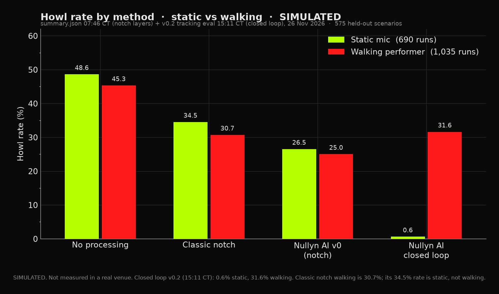
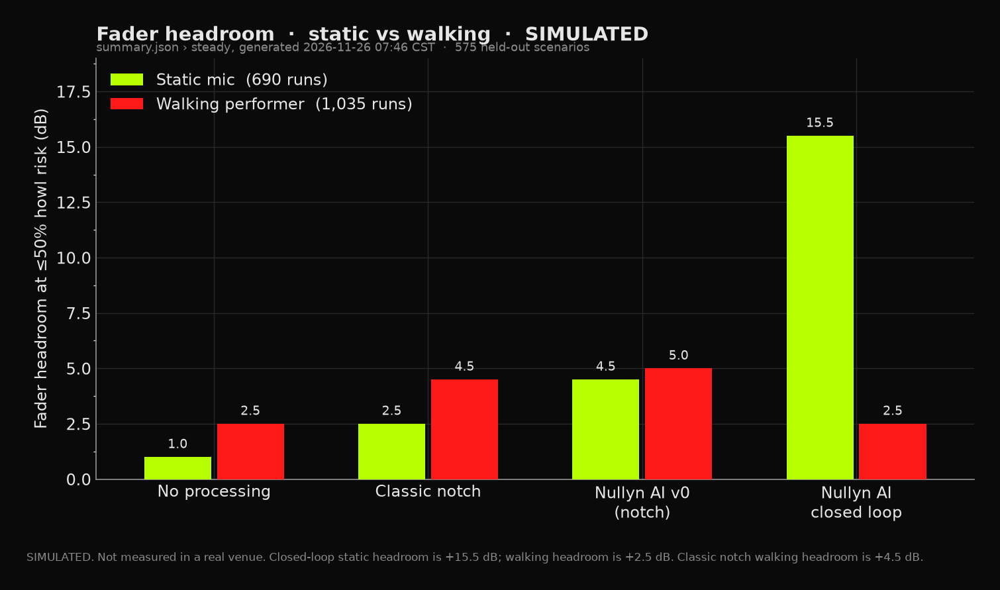
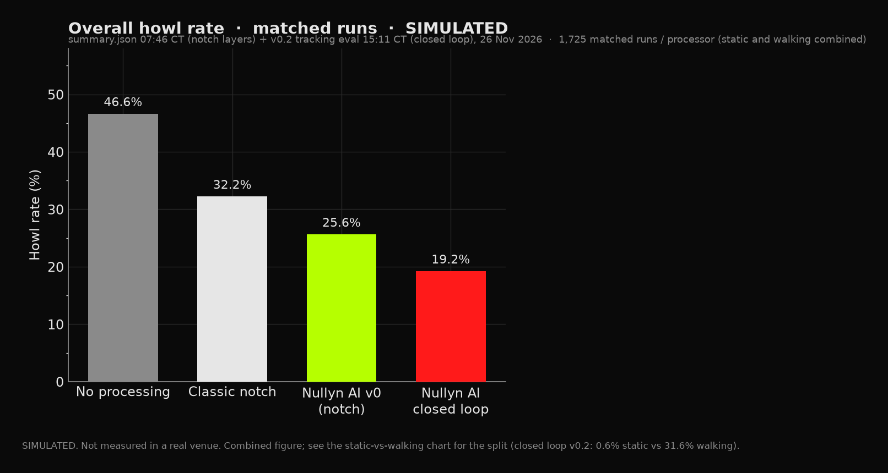
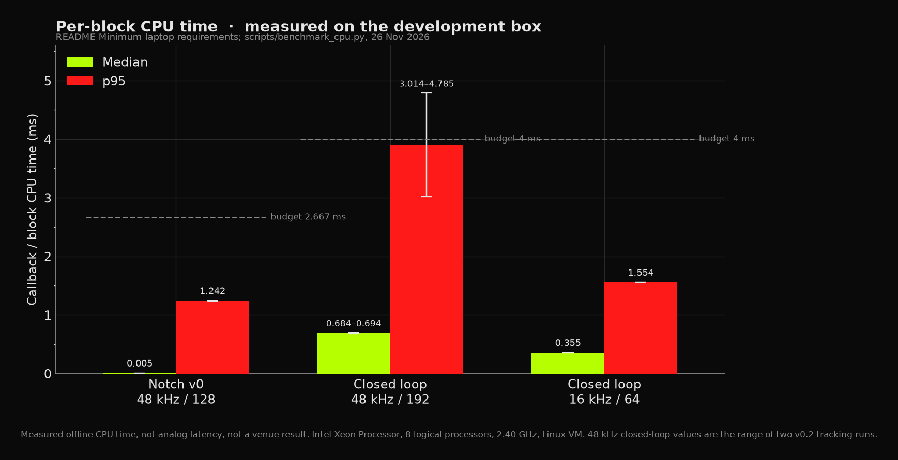

# Nullyn AI

[](https://github.com/krish-mm/nullyn-ai-defeedback)
[](https://github.com/krish-mm/nullyn-ai-defeedback#roadmap)

**Active development, v1 laptop prototype.** This is an ongoing project, and collaborators are welcome.

Project website: [nullyn.ai](https://nullyn.ai)

Python implementation of the Nullyn AI acoustic feedback suppressor, for the
v1 laptop prototype and for offline experiments.

Nullyn AI sits on a microphone channel as an insert. A side-chain detector
decides which spectral peaks are howl and steers a bank of per-sample IIR
notch filters. The detector never delays the audio. When a speaker-feed
reference is available, a closed-loop canceller subtracts predicted feedback
first and the notch layer acts as fallback. The canceller lives in
`src/nullyn/closedloop/` so that package can be left out of a public release
if needed.

Maintainer: Krish Moodbidri. Room validation is planned with working FOH
engineers.

## Project status

**What works now**

- Installable `nullyn` package with `process(mic_block, ref_block=None)`
- Notch layer, steered by Nullyn AI v0 or a classic detector
- Closed-loop canceller (optional package) for when a speaker-feed reference is available
- Offline WAV CLI, a real-time v1 CLI for a USB audio interface, and a synthetic feedback demo
- Tests and a short algorithm paper (`paper/nullyn-algorithm.pdf`)
- Simulated results only, with run counts, in [Results](#results)

**In progress**

- **Moving-microphone tracking** — still the main open algorithm problem, improved in 0.2.0 but not solved. SIMULATED (same 575 held-out scenarios, gains, and seeds as `summary.json`, 07:46 CT; closed-loop re-run 15:11 CT, 26 Nov 2026, America/Chicago): the Nullyn AI closed loop howled in **0.6%** of static-mic runs (4 / 690; was 0.7%) and **31.6%** of walking-performer runs (327 / 1,035; was 37.6%). The classic notch still howled in **30.7%** of those walking runs, so the closed loop remains slightly behind on walking. (The classic notch's 34.5% howl rate is for a static mic, not a walking one.)
- **Real-room tests** of the v1 laptop path, logged with `scripts/record_session.py`. No real-venue numbers yet.
- **Latency on real laptops**, especially Windows ASIO and macOS CoreAudio, which have not been measured.

**Every performance number in this repository is simulated**, unless a
section is explicitly labelled as a real-room measurement. Nothing here has
been measured in a real venue, on a real microphone or loudspeaker, or on
the v1 USB-interface laptop path. The closed-loop simulation covers less
than a fifth of its planned held-out scenarios. See [Results](#results)
and `paper/nullyn-algorithm.pdf`.

## Collaborators welcome

If you work in live sound, signal processing, or embedded audio, there is
room to help. Please read [CONTRIBUTING.md](CONTRIBUTING.md) and open an
issue with one of the [issue templates](.github/ISSUE_TEMPLATE/) when you
start something. Look for the `help wanted` and `good first issue` labels.

Concrete areas we need help with:

- **Moving-mic tracking.** Ideas and tests for making the closed loop keep up when a performer walks (foreground/background filters, adaptation control, variable step size). This is the highest-priority algorithm gap.
- **Windows / macOS latency tests.** Run `nullyn rt` on a real USB interface, report callback times, PortAudio latency, and analog-to-analog delay if you can measure it. These platforms are unmeasured.
- **Real-room recordings.** Use [`scripts/record_session.py`](scripts/record_session.py) to log latency, gain-before-feedback steps and howl events, then file a [Room test](.github/ISSUE_TEMPLATE/room_test.md) issue. Do not attach recordings of people without their permission.
- **Embedded / Daisy ports.** The v2 stage is a dedicated circuit running the same algorithms (for example on a Daisy Seed class board). Ports, timing measurements and memory-budget work are useful now, even before a board is frozen.

Bug reports use the [bug report](.github/ISSUE_TEMPLATE/bug_report.md) template; new capability uses the [feature request](.github/ISSUE_TEMPLATE/feature_request.md) template.

## Roadmap

The roadmap has three stages. There are no dates.

| Stage | What it is | What it must prove |
|---|---|---|
| **v1: laptop prototype** | The Nullyn AI algorithms running in real time on a laptop, with a USB audio interface providing the microphone input, the optional reference input and the output | That the simulated behaviour holds in real rooms. Measure round-trip latency and the external loop-delay condition. Collect real failures, with working FOH engineers. |
| **v2: our own circuit** | A dedicated hardware device running the same algorithms | That the latency and compute budgets hold on embedded hardware |
| **v3: deploy at scale** | Production and wide deployment | Reliability across many venues and operators |

v1 is the current stage.

## Install

Python 3.10 or newer.

```bash
python3 -m venv .venv
source .venv/bin/activate          # Windows: .venv\Scripts\activate
pip install -e ".[dev]"
# optional, for the real-time USB interface path:
pip install -e ".[realtime]"
```

## Quickstart

Synthetic delay-line demo (not a venue measurement):

```bash
nullyn demo
# or
python -m nullyn demo -o /tmp/nullyn-demo.wav
```

Offline files. Microphone only (notch layer). Microphone plus a speaker-feed
reference (closed loop, if the `closedloop` package is present):

```bash
nullyn process mic.wav -o out.wav --mode notch
nullyn process mic.wav --ref speaker_ref.wav -o out.wav --mode auto
```

Streaming API:

```python
from nullyn import NullynEngine
import soundfile as sf

mic, fs = sf.read("mic.wav")
engine = NullynEngine(fs=fs, mode="auto")          # auto: closed loop if ref is passed
out = engine.process(mic)                          # notch only
# out = engine.process(mic, speaker_ref)           # closed loop
sf.write("out.wav", out, fs)
```

## v1 laptop setup

The v1 prototype runs the same algorithm in real time on a laptop. Conversion
is done by a USB audio interface, not by this software:

**microphone → interface XLR in → laptop (Nullyn AI) → interface line out → console**

For the closed loop, also feed a line-level copy of what the speakers play
into a second input on the interface (a console aux or main send, or a
speaker-level tap passed through a pad — the software expects a line-level
reference):

**speaker feed → interface input 2 → Nullyn AI reference**

Input and output can be different devices (`--input-device` and
`--output-device`). Using two unsynchronised interfaces for input and output
is possible in the CLI but is a poor idea for a feedback loop; prefer one
interface for both.

```bash
nullyn rt --list-devices
nullyn rt \
  --input-device "Scarlett" \
  --output-device "Scarlett" \
  --mic-channel 1 \
  --ref-channel 2 \
  --output-channel 1 \
  --samplerate 48000 \
  --blocksize 128
```

The command prints the callback block size in milliseconds, PortAudio's
reported input and output latency if the driver provides it, and running
callback CPU time (median / p95 / max). Those figures are not an
analog-to-analog measurement. `--soundcheck 3` runs three seconds of
closed-loop path identification (probe noise) before passing audio.

To log a room test for the Real-time results table, use
`scripts/record_session.py` (see [Results](#results)).

## Hardware to try it

You need an interface with **at least one XLR microphone input** and a
**line-level output** back to the console. A second input is required for
the closed-loop reference. Prices below are as shown on the linked page
when checked on **26 November 2026, America/Chicago**. They will change.
Dead links were dropped (the former official PreSonus AudioBox USB 96
black page returned 404 and is not listed). This is not a purchase, and
no order will be placed unless Krish Moodbidri approves a specific item
and price.

| Interface | Why it fits | Price as shown | Source (checked 26 Nov 2026, CT) |
|---|---|---|---|
| Focusrite Scarlett Solo, 4th Gen | 1 mic preamp, 1 line/instrument input, 2 balanced line outputs, USB-C. The second input is line/instrument, not a second XLR. | **$129.99** sale, **$159.99** regular. The maker page also showed a sold-out message when checked. | [us.focusrite.com/products/scarlett-solo](https://us.focusrite.com/products/scarlett-solo) |
| Focusrite Scarlett 2i2, 4th Gen | 2 combo XLR/TRS inputs and 2 balanced line outputs. The better closed-loop fit of the two Scarletts, because the reference can use a second combo jack. | **$189.99** sale, **$224.99** regular. The maker page also showed a sold-out message when checked. | [us.focusrite.com/products/scarlett-2i2](https://us.focusrite.com/products/scarlett-2i2) |
| Behringer U-Phoria UMC202HD | 2 combo XLR/TRS inputs and line outputs, 24-bit / 192 kHz. The official Behringer product page lists no price, so the retailer page is the price source. | **$86.90**, in stock | [sweetwater.com/store/detail/UMC202HD](https://www.sweetwater.com/store/detail/UMC202HD--behringer-u-phoria-umc202hd-usb-audio-interface) |
| PreSonus Studio 24c | 2 combo XLR/TRS inputs, 2 balanced ¼-inch TRS line outputs, USB-C. | **$157.99** regular; the maker page showed the unit as sold out. | [presonus.com/products/studio-24c](https://www.presonus.com/products/studio-24c) |
| M-Audio M-Track Solo | 1 combo XLR input plus a ¼-inch instrument/line input, and line outputs. The official maker page ([m-audio.com](https://www.m-audio.com/audio-midi-interfaces/m-track-solo.html)) lists RCA stereo line outputs and does not show a price, so the retailer page is the price source. Only one XLR: the reference would use the ¼-inch input. | **$49.00**, in stock | [sweetwater.com/store/detail/MTrackSolo](https://www.sweetwater.com/store/detail/MTrackSolo--m-audio-m-track-solo-usb-audio-interface) |

## Minimum laptop requirements

These figures were measured by running `scripts/benchmark_cpu.py` on the
development box, **26 November 2026**. That machine reports itself as an
**Intel(R) Xeon(R) Processor, 8 logical processors, 2.40 GHz**, running
Linux 6.12 on x86_64, Python 3.13. The box is a virtual machine and does
not expose a more specific CPU SKU (CPUID family 6, model 207). The
benchmark calls `NullynEngine.process` in a tight loop. It is **offline
CPU time**, not analog I/O latency, and not a measurement of Windows ASIO
or macOS CoreAudio.

| Mode | Rate / internal block | Budget | Median | p95 | Max | Median load |
|---|---|---|---|---|---|---|
| Notch, Nullyn AI v0 | 48 kHz, 128 samples | 2.667 ms | 0.005 ms | 1.242 ms | 2.844 ms | 0.2% |
| Closed loop, Nullyn AI v0 (tracking, 0.2.0) | 48 kHz, 192 samples (4 ms) | 4.000 ms | 0.684–0.694 ms | 3.014–4.785 ms | 9.4–18.7 ms | 17.1–17.3% |
| Closed loop, Nullyn AI v0 (tracking, 0.2.0) | 16 kHz, 64 samples | 4.000 ms | 0.355 ms | 1.554 ms | 1.712 ms | 8.9% |

Median load is modest, including for the closed loop. On this shared VM,
though, p95 callback time approached or exceeded the 4 ms closed-loop
budget, and the worst block clearly exceeded it. Real-time audio has to
meet the budget almost every block, not on average.

**Practical reading, with headroom.** A 64-bit laptop that can run Python
3.10+ should handle the notch path with a large median margin on a machine
in this class. For closed-loop v1, start at 48 kHz with a 128–256 sample
callback (about 2.7–5.3 ms of buffer latency), close other heavy
applications, and watch the callback times that `nullyn rt` prints. If p95
exceeds the buffer, raise `--blocksize`. Plan for several times the median
load we measured — the p95/max on a noisy host is the number that matters,
and we did not measure a quiet personal laptop.

Performance work is tracked in the pinned
[performance tracking issue](https://github.com/krish-mm/nullyn-ai-defeedback/issues/27). The
per-stage time and space complexity and the v0.2.0 latency baseline are in
[docs/performance.md](docs/performance.md).

**Unknown, and not claimed here:** Windows ASIO performance, macOS
CoreAudio performance, USB analog-to-analog round-trip, thermal
throttling, and driver quality on any particular interface. Those have to
be measured on the laptop and interface you actually use.

## Results

### Simulated

Labelled **SIMULATED**. pyroomacoustics image-source shoebox rooms, 16 kHz,
4 s runs. Not measured in real venues or on hardware. Notch-layer numbers
are from `summary.json` from the research simulator, generated 26 November
2026, 07:46 CT, and the unpublished Nullyn AI whitepaper v0.3. Closed-loop
numbers are a re-run of that same steady protocol (identical 575 held-out
scenarios, gains, and seeds) on 26 November 2026, 15:11 CT,
America/Chicago, with the v0.2 tracking canceller
(`docs/results/closedloop-v0.2-steady.json`). The closed-loop
protocols cover less than a fifth of the planned 3,900 held-out scenarios.

**Steady protocol** — 575 held-out scenarios, 1,725 matched runs per
processor (690 static microphone, 1,035 walking performer):

| Metric | No processing | Classic notch | Nullyn AI v0 (notch) | Nullyn AI closed loop |
|---|---|---|---|---|
| Howl rate, all | 46.6% | 32.2% | 25.6% | **19.2%** |
| Static mic (690 runs) | 48.6% | 34.5% | 26.5% | **0.6%** |
| Walking performer (1,035 runs) | 45.3% | 30.7% | **25.0%** | 31.6% |
| Fader headroom ≤50% (all / static / walking) | +1.0 / +1.0 / +2.5 dB | +3.5 / +2.5 / +4.5 dB | +5.0 / +4.5 / +5.0 dB | +6.0 / **+15.5** / +3.0 dB |



*SIMULATED. Howl rate on the closed-loop steady protocol: 575 held-out scenarios, 690 static-mic runs and 1,035 walking-performer runs per processor. Notch-layer bars from `summary.json`, 07:46 CT, 26 Nov 2026. Closed-loop bars from the v0.2 tracking re-run, 15:11 CT, same scenarios, gains, and seeds. The Nullyn AI closed loop howled in 0.6% of static runs and 31.6% of walking runs; the classic notch howled in 30.7% of walking runs (its 34.5% rate is static, not walking).*



*SIMULATED. Fader headroom at ≤50% howl risk, same steady protocol and run counts as the chart above. Closed-loop bars from the v0.2 tracking re-run, 15:11 CT. The closed loop reaches +15.5 dB on static mics and +3.0 dB when the performer walks; the classic notch reaches +4.5 dB on the walking runs.*



*SIMULATED. Overall howl rate on 1,725 matched runs per processor (575 held-out scenarios, static and walking combined). Closed-loop bar from the v0.2 tracking re-run, 15:11 CT (19.2%); other bars from `summary.json`, 07:46 CT.*



*Measured offline CPU time of `NullynEngine.process` on an Intel Xeon Processor (8 logical processors, 2.40 GHz, Linux VM), 26 November 2026, as reported in [Minimum laptop requirements](#minimum-laptop-requirements). This is not analog I/O latency and not a venue result. The 48 kHz closed-loop bars show the range of two v0.2 tracking runs (median 0.684–0.694 ms, p95 3.014–4.785 ms) against a 4.000 ms budget.*

Moving mics are still the open problem. On walking runs the v0.2 closed
loop (31.6%, down from 37.6% in 0.1.0) improved but remains slightly
behind the classic notch (30.7%) and the notch layer alone (25.0%). Its
0.6% static-mic howl rate and +15.5 dB static headroom did not regress.
Details, operator and ablation tables, run counts and limitations for the
earlier 0.1.0 closed loop are in `paper/nullyn-algorithm.pdf` (and
`paper/nullyn-algorithm.md`).

This repository does not include simulator sweep dumps.

### Real-time

Pending: Krish's room tests. No real-room numbers are reported here.

Use `scripts/record_session.py` to log callback latency, gain-before-feedback
steps and howl events to CSV. After a session, file a [Room test](.github/ISSUE_TEMPLATE/room_test.md)
issue (or hand Krish the CSV) and fill the table below from the log — do
not estimate the numbers.

```bash
nullyn rt --list-devices
python scripts/record_session.py -o session_log.csv \
  --input-device "Scarlett" --output-device "Scarlett" \
  --mic-channel 1 --ref-channel 2 \
  --blocksize 128 --samplerate 48000
```

During the session: `g 3` logs a +3 dB gain step, `h` logs that a howl was
heard, `c` logs that it cleared, `m` adds a note, `q` quits.

| Date (CT) | Venue type | Laptop / OS | Interface | Mode | Sample rate / block | Callback median / p95 / max (ms) | Reported RT (ms) | GBF steps (dB) | Howl events | Notes |
|---|---|---|---|---|---|---|---|---|---|---|
| — | pending | — | — | — | — | — | — | — | — | Krish's room tests have not been run |

## Package layout

```
src/nullyn/              installable package
  features.py            side-chain peak features
  filters.py, notch.py   IIR notch bank; classic and Nullyn AI v0 detectors
  engine.py              process(mic_block, ref_block=None)
  closedloop/            PEM-prewhitened adaptive canceller (optional)
  data/                  packed v0 / v0.1 weights and classic thresholds
scripts/record_session.py
scripts/benchmark_cpu.py
scripts/bench_latency.py     seeded closed-loop latency benchmark (median/p95/p99/max, jitter)
scripts/profile_hotspots.py  per-stage timers and cProfile
scripts/quality_gate.py      held-out howl/LSD check for performance PRs (needs the research workspace)
docs/performance.md          per-block pipeline, time/space complexity, latency baseline
paper/                   algorithm note (Markdown + PDF)
```

Tests: `pytest`. The packaged weights are the small trained models already
used in the research simulator (`nullyn_v0`, kept after the first learning
loop; `nullyn_v0_1` is shipped for comparison and was not adopted).

## License

Released under the MIT License, see LICENSE.

## Learn more

- Project website: [nullyn.ai](https://nullyn.ai)
- This repository, including issues and discussions
- Maintainer: Krish Moodbidri

## Contributing

See [CONTRIBUTING.md](CONTRIBUTING.md). Please run `pytest` and
`python -m nullyn demo` before opening a pull request.
